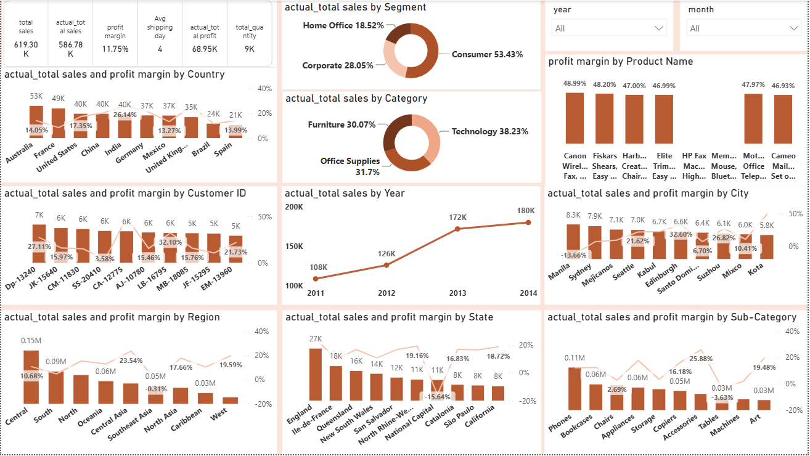
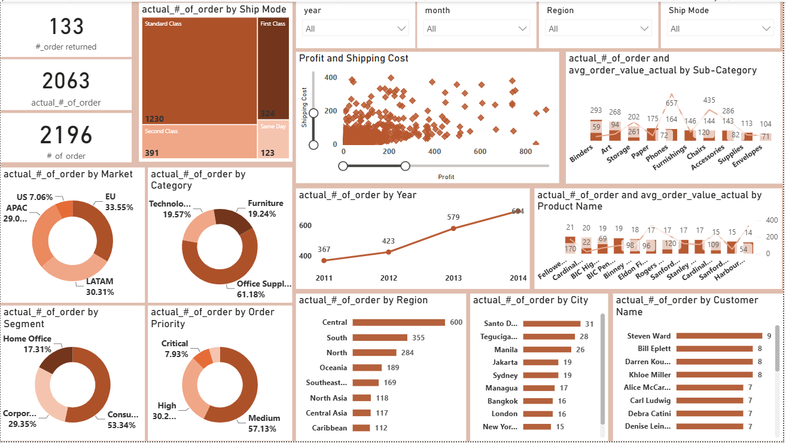
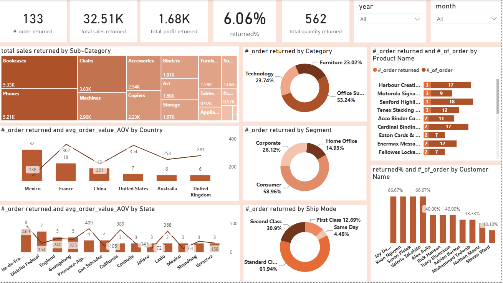

# Global Store | Sales, Orders & Returns Analytics

### Power BI | Sales Analytics | Profitability | Business Intelligence

An interactive, multi-page **Power BI Business Intelligence project** designed to analyze global retail operations across sales, orders, profitability, shipping, and product returns.

The project transforms retail data into visual insights to support performance monitoring, identify business trends, and explore opportunities for operational improvement.

---

## Project Overview

Retail businesses need clear visibility into sales performance, customer demand, operational efficiency, and product returns.

This project provides three analytical dashboards covering:

- Sales performance and profitability
- Order volume and distribution
- Customer and market segmentation
- Product category and sub-category performance
- Shipping methods and order priorities
- Product returns and their financial impact
- Geographic performance across countries and regions

**Project Goal:** Provide an integrated view of retail performance through interactive Power BI reporting.

---

## Tools & Technologies

| Tool / Skill | Application |
|---|---|
| Microsoft Power BI | Interactive dashboards and data visualization |
| Business Intelligence | KPI monitoring and performance reporting |
| Sales Analytics | Sales and profitability analysis |
| Data Visualization | Comparative and trend analysis |
| Power BI Slicers | Interactive filtering by time, region, and shipping attributes |

---

## Dashboard Gallery

### 1. Sales Performance Dashboard

This dashboard provides an overview of retail sales, profitability, and business performance.

**Key Metrics:**

| KPI | Displayed Value |
|---|---:|
| Total Sales | 619.30K |
| Actual Total Sales | 586.78K |
| Total Profit | 68.95K |
| Profit Margin | 11.75% |
| Total Quantity | 9K |
| Average Shipping Days | 4 |

**Key Analytical Areas:**

- Sales and profit margins by country
- Sales performance across customer segments
- Sales distribution by product category
- Historical sales trends
- Regional profitability
- Product and sub-category performance
- City-level sales and profit comparisons

The dashboard enables users to explore performance across multiple geographic and product dimensions.

---

### 2. Orders Analytics Dashboard

This dashboard focuses on order activity, market distribution, and shipping operations.

**Key Metrics:**

| KPI | Displayed Value |
|---|---:|
| Number of Orders | 2,196 |
| Actual Number of Orders | 2,063 |
| Returned Orders | 133 |

**Key Analytical Areas:**

- Orders by shipping mode
- Orders across global markets
- Order distribution by customer segment
- Order volume by category
- Orders by region and city
- Order priority analysis
- Annual order trends
- Shipping cost and profit relationships

This page supports the exploration of order patterns and operational performance.

---

### 3. Returns Analytics Dashboard

This dashboard analyzes returned orders and their relationship with product categories, customer segments, and geographic markets.

**Key Metrics:**

| KPI | Displayed Value |
|---|---:|
| Returned Orders | 133 |
| Returned Sales | 32.51K |
| Returned Profit | 1.68K |
| Return Rate | 6.06% |
| Returned Quantity | 562 |

**Key Analytical Areas:**

- Returned sales by product sub-category
- Returned orders by category
- Returns across customer segments
- Returned order values by country and state
- Returns by shipping method
- Product-level return analysis
- Customer-level return patterns

This dashboard helps explore return distribution and potential areas for further investigation.

---

## Business Questions

The project explores the following questions:

1. Which product categories and regions contribute the most to sales?
2. How does profitability vary across geographic markets?
3. Which customer segments account for the largest share of revenue?
4. How has sales and order volume changed over time?
5. How are orders distributed across shipping methods?
6. Which product categories experience higher return activity?
7. How do product returns relate to sales performance and profitability?
8. Which markets and product groups warrant closer business investigation?

---

## Selected Business Insights

### Sales Performance

- The Consumer segment accounts for the largest share of actual sales at 53.43%.
- Technology represents the largest product category by actual sales share at 38.23%.
- The dashboard displays an upward annual sales trend from 2011 to 2014.

### Orders & Operations

- Standard Class accounts for the largest share of orders by shipping mode.
- The Consumer segment represents the largest proportion of orders.
- Orders vary across global markets, regions, and product categories.

### Returns Analysis

- The displayed overall return rate is 6.06%.
- Office Supplies accounts for the largest share of returned orders by category.
- Store return patterns vary by product sub-category, market, and customer segment.

These observations describe the displayed report results and do not establish causal relationships.

---

## Business Recommendations

Based on the dashboard analysis, the following areas could be explored:

1. **Profitability Optimization:** Investigate markets and product categories with lower profit margins to identify possible operational or pricing improvements.

2. **Customer Segmentation:** Study high-contributing customer segments to understand purchasing behavior and opportunities for targeted marketing.

3. **Product Performance:** Evaluate product categories with strong sales performance alongside their profitability.

4. **Returns Management:** Investigate sub-categories and geographic locations with higher return activity to identify potential quality, fulfillment, or customer-experience issues.

5. **Shipping Efficiency:** Compare shipping methods against order volume, shipping costs, and profitability to identify potential operational improvements.

These are proposed business actions, not measured outcomes of implemented changes.

---

## Report Features

- Three interactive analytical pages
- KPI cards and performance indicators
- Bar and column charts
- Line and combination charts
- Donut charts and treemaps
- Scatter plot analysis
- Geographic and product comparisons
- Interactive slicers and filtering
- Sales, Orders, and Returns analysis

---

## Repository Structure

    global-store-sales-returns-analytics/
    |
    |-- README.md
    |-- global-store.pbix
    |
    |-- images/
        |-- sales-dashboard.png
        |-- orders-dashboard.png
        |-- returns-dashboard.png

---

## Project Files

**Power BI Report:** [Download PBIX](global-store.pbix)

The report can be opened using Microsoft Power BI Desktop to explore the interactive dashboards.

---

## Important Notes

- All displayed metrics are based on the report's original data model and filter context.
- Financial units are presented as displayed in the source report; no currency has been assumed.
- Sales, order, and return metrics may use different definitions depending on the underlying measures.
- Findings represent dataset-level analysis rather than documented real-world business improvements.

---

## Author

**Sayed Said**  
Data Analyst | Power BI Developer

Specializing in Power BI, SQL, DAX, Power Query, Data Visualization, and Business Intelligence.

[LinkedIn](https://www.linkedin.com/in/sayed-said/) | [GitHub](https://github.com/Sayed-said93)

---

*Turning Data into Actionable Insights.*
